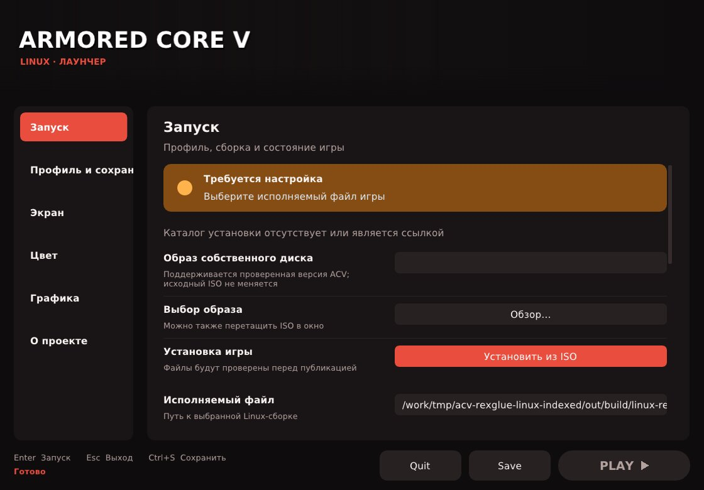

# Build & install ACV

[English](Install.MD) · [Русский](Install.RU.MD) · [Releases](https://github.com/GrayRats/ArmoredcoreV-Port/releases) · [Source](https://github.com/GrayRats/ArmoredcoreV-Port)

> **Platform:** Linux x86-64-v2 is the maintained application target. The SDK also provides Windows x64 presets. The ACV application and its Python/launcher backend still contain POSIX dependencies; a native Windows game build is not available from this tree today.

## Contents

1. [Choose an installation route](#1-choose-an-installation-route)
2. [Tools, CPU and ABI requirements](#2-tools-cpu-and-abi-requirements)
3. [Prepare the sources](#3-prepare-the-sources)
4. [Build on Linux](#4-build-on-linux)
5. [Windows x64: SDK build and application port status](#5-windows-x64-sdk-build-and-application-port-status)
6. [Assemble a Linux package](#6-assemble-a-linux-package)
7. [GitHub Packages and build environment](#7-github-packages-and-build-environment)
8. [Troubleshooting](#8-troubleshooting)

## 1. Choose an installation route

| Route | Contents | What you can do |
|---|---|---|
| Existing Linux package | Launcher, runtime, game ELF, data, licenses, manifest | Run on a compatible Linux system |
| Repository/source archive | Project shims, tools, CMake templates, configuration examples, documentation | Build the launcher and SDK; maintain the ACV port |
| Complete ACV development workspace | Sources above **plus** generated translation, entrypoint project, adjusting thunks and matching patched SDK | Rebuild the game using the maintainer procedure below |
| GitHub Packages image | Linux compiler and build dependencies | Compile in an isolated toolchain environment |

The GitHub source ZIP/tarball does not contain the ignored `tmp/` workspace, generated translation, external dependency checkouts or SDK build outputs. Extracting a source archive alone does not recreate the accepted game build.

### Install the existing Linux package

Download these assets from [release 1.1](https://github.com/GrayRats/ArmoredcoreV-Port/releases/tag/v1.1.0):

- `ACV-Linux-release-1.0.tar.zst.part-00`
- `ACV-Linux-release-1.0.tar.zst.part-01`
- `ACV-Linux-release-1.0.parts.sha256`
- `ACV-Linux-release-1.0.tar.zst.sha256`
- `ACV-Linux-release-1.0-PROVENANCE.md`

In the download directory:

```bash
sha256sum -c ACV-Linux-release-1.0.parts.sha256
cat ACV-Linux-release-1.0.tar.zst.part-* > ACV-Linux-release-1.0.tar.zst
sha256sum -c ACV-Linux-release-1.0.tar.zst.sha256
zstd -t ACV-Linux-release-1.0.tar.zst
tar --zstd -xf ACV-Linux-release-1.0.tar.zst
./ACV-Linux-release-1.0/start.sh
```

The attached binary package identifies itself as **1.0**. Release **1.1** also distributes project sources and documentation. This packaging does not establish a new FPS result.


*Existing gameplay image from the Linux port; it is not evidence of a Windows build or a performance benchmark.*

## 2. Tools, CPU and ABI requirements

| Component | Requirement |
|---|---|
| CPU | x86-64-v2; compile with `-march=x86-64-v2` |
| Compiler | LLVM Clang **18+**, with C++23 support; the SDK rejects GCC |
| Build tools | CMake **3.25+**, Ninja, Git; the launcher itself requires CMake 3.24+ |
| Scripting | Python **3.11+**, Node.js **22+**, npm |
| Linux launcher | SDL2, OpenGL 3.3, X11/XWayland; SDL2 and ImGui are fetched at pinned revisions |
| Game renderer | Vulkan driver and capabilities supported by the selected SDK GPU plugin |
| Windows SDK | Visual Studio 2022 C++ build tools, Windows SDK, LLVM Clang 18+, CMake, Ninja |

`x86-64-v2` is a CPU instruction baseline, not a glibc or Windows compatibility guarantee. Avoid `-march=native` when distributing a v2 build. Release mode supplies optimization; there is no need to add `-ffast-math`.

> **Existing binary ABI, checked 2026-10-29:** `librexruntime.so` requires symbols up to `GLIBC_2.44` and `GLIBCXX_3.4.36`; the game ELF requires `GLIBC_2.43`/`GLIBCXX_3.4.35`. The launcher requires `GLIBC_2.43`/`GLIBCXX_3.4.32`. A stock older distribution may need a rebuild of the complete dependency/runtime set. Do not replace its system libc with a copied library.

Check a supplied binary on the target machine:

```bash
lscpu
getconf GNU_LIBC_VERSION
readelf --version-info ACV-Linux-release-1.0/bin/game/librexruntime.so
ldd ACV-Linux-release-1.0/bin/game/acv_linux_probe
```

### Ubuntu 24.04 build dependencies

These install the **build environment**; they do not make the existing newer-glibc game binary compatible with Ubuntu 24.04.

```bash
sudo apt-get update
sudo apt-get install git git-lfs build-essential clang-18 lld-18 cmake ninja-build \
  python3 pkg-config libvulkan-dev libgl1-mesa-dev libegl1-mesa-dev \
  libx11-dev libxext-dev libxrandr-dev libxcursor-dev libxi-dev libxinerama-dev \
  libwayland-dev libxkbcommon-dev libasound2-dev libpulse-dev libudev-dev \
  fonts-dejavu-core zstd patchelf
```

Install Node 22+ separately from [Node.js](https://nodejs.org/en/download), or use the [build container](#7-github-packages-and-build-environment). Check `node --version`: Ubuntu's default Node package may be too old for the logger.

### Arch/CachyOS build dependencies

```bash
sudo pacman -S --needed base-devel clang lld cmake ninja git python nodejs npm \
  pkgconf vulkan-headers vulkan-icd-loader mesa libglvnd libx11 libxrandr \
  libxcursor libxi libxinerama wayland libxkbcommon alsa-lib libpulse \
  systemd-libs zstd patchelf ttf-dejavu
```

Install the appropriate GPU driver for your hardware separately. Neither package list substitutes for a working Vulkan driver.

## 3. Prepare the sources

```bash
git clone https://github.com/GrayRats/ArmoredcoreV-Port.git ACV
cd ACV
git rev-parse HEAD
node --version
python3 --version
clang++ --version
cmake --version
ninja --version
npm ci --prefix tools/decomp-logging
```

`npm ci` bootstraps the logger. Use the logger for subsequent analysis, build and packaging commands. Existing workspaces should preserve their current branch and local changes.

Fetch dependencies at the versions used by the project:

```bash
git clone https://github.com/TekRantGaming/trg-launcher.git tools/trg-launcher
git -C tools/trg-launcher checkout --detach b384a28c712c9320eea8f9d50639dec49981b6c1
git clone https://github.com/rexglue/rexglue-sdk.git tools/rexglue-sdk
git -C tools/rexglue-sdk checkout --detach c94f5ebdcb3c9d1a460ca48e04f9758448f8d518
git -C tools/rexglue-sdk submodule update --init --recursive
```

Run these clone commands only for missing directories. The SDK revision is the **base** of the ACV runtime modifications, not a complete replay of the accepted patched runtime. Pinned SDL2/ImGui revisions are recorded in [dependencies.json](tools/acv-trg-launcher/dependencies.json); CMake fetches and checks them. External source licenses remain with those projects.

Create a configuration only when none exists:

```bash
test -f tools/native-rexglue/acv.config || \
  cp tools/native-rexglue/acv.config.example tools/native-rexglue/acv.config
```

Set your pilot name and gamertag in `[profile]`. Keep the existing configuration on updates. The sample file is not a replacement for an existing user's settings or for the ACV-FSI launch profile.

## 4. Build on Linux

### 4.1 Build the SDK in Release, x86-64-v2

From the repository root:

```bash
node tools/decomp-logging/cli.mjs run --stage sdk-configure --timeout-ms 600000 -- \
  cmake --preset linux-amd64 -S tools/rexglue-sdk \
  -DCMAKE_C_COMPILER=clang -DCMAKE_CXX_COMPILER=clang++ \
  -DCMAKE_C_FLAGS=-march=x86-64-v2 -DCMAKE_CXX_FLAGS=-march=x86-64-v2 \
  -DREXGLUE_USE_VULKAN=ON -DREXGLUE_USE_D3D12=OFF \
  -DREXGLUE_ENABLE_TRACY=OFF -DREXGLUE_ENABLE_PERF_COUNTERS=OFF \
  -DREXGLUE_BUILD_TESTS=OFF -DREXGLUE_ENABLE_FIDELITYFX=OFF
node tools/decomp-logging/cli.mjs run --stage sdk-build --timeout-ms 1800000 -- \
  cmake --build tools/rexglue-sdk/out/build/linux-amd64 --config Release --parallel 4
node tools/decomp-logging/cli.mjs run --stage sdk-install --timeout-ms 600000 -- \
  cmake --install tools/rexglue-sdk/out/build/linux-amd64 --config Release \
  --prefix "$PWD/tmp/rex-sdk-install"
```

The SDK preset is multi-configuration and defaults to Debug. **Keep `--config Release` on build/install.** The commands above build a baseline SDK, with experimental FidelityFX disabled. They do not recreate the accepted ACV runtime patches. The separate [FFX helper](tools/native-rexglue/build_sdk_ffx.py) is a Linux development path, not an accepted cross-platform recipe.

### 4.2 Build the TRG launcher

The launcher needs the pinned TRG checkout and the SDK's `thirdparty/inja` headers, but not a game translation:

```bash
node tools/decomp-logging/cli.mjs run --stage trg-configure --timeout-ms 600000 -- \
  cmake -S tools/acv-trg-launcher -B tmp/acv-trg-build -G Ninja \
  -DCMAKE_BUILD_TYPE=Release -DCMAKE_C_COMPILER=clang -DCMAKE_CXX_COMPILER=clang++ \
  -DCMAKE_C_FLAGS=-march=x86-64-v2 -DCMAKE_CXX_FLAGS=-march=x86-64-v2
node tools/decomp-logging/cli.mjs run --stage trg-build --timeout-ms 600000 -- \
  cmake --build tmp/acv-trg-build --target acv-launcher --parallel 4
```

On Ubuntu, use `clang-18`/`clang++-18` if the unversioned names select an older compiler. Output: `tmp/acv-trg-build/acv-launcher`. A launcher-only build can display the UI with the game executable absent; PLAY needs a valid runtime package.



*Actual Linux source build, captured in Xvfb with software OpenGL and an isolated profile. No game was started for this screenshot.*

Clean-checkout compilation and this capture passed in [workflow run 40919963102](https://github.com/GrayRats/ArmoredcoreV-Port/actions/runs/40919963102) on Ubuntu24.04/Clang18, Release, `-march=x86-64-v2`.

### 4.3 Rebuild the game: required development inputs

The current incremental game build requires these additional inputs:

```text
tmp/acv-rexglue-linux-indexed/
  CMakeLists.txt
  acv_linux_probe_manifest.toml
  src/main.cpp
  generated/rexglue.cmake
  generated/conditional-fragments/...
tmp/acv-native-adjusting-thunks.cpp
<matching patched SDK headers, installed CMake package and runtime libraries>
```

| Missing input | Why it matters |
|---|---|
| Generated ACV C++ and registration/PCH files | The public source archive excludes generated output |
| Manifest and entrypoint project | `build_linux.py` expects the existing project, not an empty directory |
| Adjusting thunks | The generator also reads a private registry and scan inputs; running it on a clean clone is insufficient |
| Matching patched SDK | Saved patches are evidence and repair resources; there is no single validated clean-clone replay command for the accepted runtime |

Restore a complete matching development workspace before continuing. Do not create empty placeholder files or silently substitute the stock SDK. [Native build evidence](docs/NATIVE_REXGLUE_LINUX.md), [baseline hashes](tools/native-rexglue/RUNTIME_BASELINE.json) and [tool routing](TOOLS.MD) describe these inputs.

For a **restored workspace**, the maintainer configure/build sequence is:

```bash
cp tools/native-rexglue/CMakeLists.linux-probe.txt tmp/acv-rexglue-linux-indexed/CMakeLists.txt
node tools/decomp-logging/cli.mjs run --stage acv-configure --timeout-ms 600000 -- \
  cmake -S tmp/acv-rexglue-linux-indexed \
  -B tmp/acv-rexglue-linux-indexed/out/build/linux-release -G Ninja \
  -DCMAKE_BUILD_TYPE=Release -DCMAKE_CXX_COMPILER=clang++ \
  -DCMAKE_CXX_FLAGS=-march=x86-64-v2 \
  -DACV_PROJECT_ROOT="$PWD" -DCMAKE_PREFIX_PATH=/absolute/path/to/matching/patched/sdk
node tools/decomp-logging/cli.mjs run --stage acv-build --timeout-ms 1800000 -- \
  python3 tools/native-rexglue/build_linux.py --jobs 4 \
  --runtime-artifact tmp/runtime-inputs/librexruntime.so \
  --gpu-plugin-artifact tmp/runtime-inputs/librexgpu-xenos.so
```

Place the matching verified libraries in `tmp/runtime-inputs/` first. Preserve the required `libamd_fidelityfx_vk.so` beside the output ELF if that runtime uses it. Both explicit artifact options accept workspace `tmp/` inputs and check ELF/hash identity. The portable CMake template also accepts `ACV_ADJUSTING_THUNKS` when the verified thunk file is elsewhere. A reconfigured/rebuilt game is a candidate until checked.

<details>
<summary>Starting a new ReXGlue project: research example, not the accepted ACV build</summary>

The pinned CLI defines these exact options:

```bash
node tools/decomp-logging/cli.mjs run --stage acv-init --timeout-ms 120000 -- \
  tmp/rex-sdk-install/bin/rexglue init --project-name acv_linux_probe \
  --xex-path /absolute/path/to/owned/default.xex \
  --game-root /absolute/path/to/owned/game --project-root tmp/acv-new-port
node tools/decomp-logging/cli.mjs run --stage acv-codegen --timeout-ms 1800000 -- \
  tmp/rex-sdk-install/bin/rexglue codegen tmp/acv-new-port/acv_linux_probe_manifest.toml
```

Confirm the actual manifest filename produced by `init`. For reference, the manifest schema used by the ACV workspace has this shape; substitute your paths:

```toml
[project]
name = "acv_linux_probe"
sdk_version = "0.10.0"
game_root = "/absolute/path/to/owned/game"

[entrypoint]
file_path = "/absolute/path/to/owned/default.xex"
out_directory_path = "generated/conditional-fragments"
includes = [
  "/absolute/path/to/ACV/tools/native-rexglue/acv-boundaries.toml",
  "/absolute/path/to/ACV/tools/native-rexglue/acv-conditional-targets.toml",
  "/absolute/path/to/ACV/tools/native-rexglue/acv-data-referenced-functions.toml",
]
```

This is a schema example, not a complete recreation of the accepted ACV project. Analysis needs those boundary/config inputs and further project work. Stock init/codegen alone does not replace the missing workspace. Do not bypass unresolved validation with a fabricated function or edit generated shards as the durable repair.

</details>

## 5. Windows x64: SDK build and application port status

### 5.1 Prepare Developer PowerShell

Install Visual Studio 2022 Build Tools with **Desktop development with C++** and Windows SDK, LLVM Clang18+, CMake3.25+, Ninja, Git, Python3.11+ and Node22+. Open **Developer PowerShell for VS2022** with an x64 environment.

```powershell
git clone https://github.com/GrayRats/ArmoredcoreV-Port.git ACV
Set-Location ACV
clang++ --version
cmake --version
ninja --version
python --version
node --version
npm ci --prefix tools/decomp-logging
git clone https://github.com/rexglue/rexglue-sdk.git tools/rexglue-sdk
git -C tools/rexglue-sdk checkout --detach c94f5ebdcb3c9d1a460ca48e04f9758448f8d518
git -C tools/rexglue-sdk submodule update --init --recursive
```

The pinned preset selects the **`clang`/`clang++` driver**, not an assumed `clang-cl` configuration. Keep the Visual Studio SDK/library environment available to that driver.

### 5.2 Compile and install the SDK

```powershell
node tools/decomp-logging/cli.mjs run --stage win-sdk-configure --timeout-ms 600000 -- cmake --preset win-amd64 -S tools/rexglue-sdk -DCMAKE_C_FLAGS=-march=x86-64-v2 -DCMAKE_CXX_FLAGS=-march=x86-64-v2 -DREXGLUE_USE_D3D12=ON -DREXGLUE_USE_VULKAN=OFF -DREXGLUE_ENABLE_TRACY=OFF -DREXGLUE_ENABLE_PERF_COUNTERS=OFF -DREXGLUE_BUILD_TESTS=OFF -DREXGLUE_ENABLE_FIDELITYFX=OFF
node tools/decomp-logging/cli.mjs run --stage win-sdk-build --timeout-ms 1800000 -- cmake --build tools/rexglue-sdk/out/build/win-amd64 --config Release --parallel 4
node tools/decomp-logging/cli.mjs run --stage win-sdk-install --timeout-ms 600000 -- cmake --install tools/rexglue-sdk/out/build/win-amd64 --config Release --prefix "$PWD/tmp/rex-sdk-install-win"
Get-ChildItem tools/rexglue-sdk/out -Recurse -Filter rexruntime.dll
Get-ChildItem tmp/rex-sdk-install-win -Recurse -Filter *.dll
```

This is the SDK's native Windows route, documented from the pinned preset; it was not executed on Windows for this release. A Vulkan SDK build uses `REXGLUE_USE_VULKAN=ON` and requires its matching SDK dependencies. ACV's known FSI/full profile is Vulkan-specific; D3D12 build availability does not prove ACV rendering compatibility.

### 5.3 What blocks a native ACV Windows package

| Current source | Work needed before a Windows game build |
|---|---|
| `acv_compat_shims.cpp` | POSIX `dlfcn.h`, `fcntl.h`, `unistd.h` paths need a Windows implementation |
| `tools/acv-trg-launcher/process.h` | Replace/port `posix_spawn`, `poll`, process groups and signals |
| `acv_profiles.py` and Linux session tools | Port `fcntl.flock`, `/proc`, XDG/session ownership |
| `standalone.py` | It packages ELF/`.so` with `ldd` and Linux `start.sh` |
| Generated project and patched SDK | Same missing-input boundary as the Linux game build |

There is therefore no verified native ACV `.exe` build command or Windows screenshot to present. WSL2 can host the Linux **build workflow**, subject to its CPU, driver and glibc requirements; it does not convert the existing package to a native Windows application.

<details>
<summary>Windows packaging example for a future, independently verified native port</summary>

After the POSIX work is completed and a working native executable exists, collect only its actual dependencies. The following is a template, not the current ACV build:

```powershell
$VerifiedExe = "C:/verified-build/acv.exe"
$VerifiedDllDir = "C:/verified-build/runtime"
$PackageDir = "releases/ACV-Windows-candidate"
if (Test-Path $PackageDir) { throw "Choose a new output directory" }
New-Item -ItemType Directory -Path $PackageDir | Out-Null
Copy-Item $VerifiedExe $PackageDir
Copy-Item "$VerifiedDllDir/*.dll" $PackageDir
dumpbin /DEPENDENTS "$PackageDir/acv.exe"
Get-ChildItem $PackageDir -File | Get-FileHash -Algorithm SHA256 | Format-Table -AutoSize | Out-String | Set-Content "$PackageDir/SHA256.txt"
Compress-Archive -Path "$PackageDir/*" -DestinationPath "$PackageDir.zip"
```

Include dependency licenses, the implemented settings/profile backend, the relevant VC runtime where licensed/required, and a validated data-installation path. Do not rename Linux `.so` files into DLLs. Validate the package on a clean Windows system before calling it supported.

</details>

## 6. Assemble a Linux package

Prerequisites: built TRG launcher; a **matching verified** directory containing `acv_linux_probe`, `librexruntime.so`, `librexgpu-xenos.so` and, when needed, `libamd_fidelityfx_vk.so`; required licenses; the canonical `acv.config`.

From the repository root, Ubuntu example:

```bash
node tools/decomp-logging/cli.mjs run --stage acv-package --timeout-ms 600000 -- \
  python3 tools/acv-launcher/standalone.py --frontend trg \
  --launcher tmp/acv-trg-build/acv-launcher \
  --runtime-dir /absolute/path/to/verified/runtime \
  --font-dir /usr/share/fonts/truetype/dejavu \
  --font-license /usr/share/doc/fonts-dejavu-core/copyright \
  --skip-settings-tests --out tmp/ACV-Linux-candidate
node tools/decomp-logging/cli.mjs run --stage acv-package-verify --timeout-ms 600000 -- \
  python3 tools/acv-trg-launcher/verify_package.py tmp/ACV-Linux-candidate
```

Arch uses `/usr/share/fonts/TTF` and `/usr/share/licenses/ttf-dejavu/LICENSE`; those remain the defaults. `--skip-settings-tests` skips the settings test file, including effect checks, and records the omission. Other packaging checks still run. This project has not accepted CAS/FSR effect tests.

The destination must be new. Packaging uses staging and verifies hashes/dependencies before publication. It never deletes an existing output. Supplying a rebuilt runtime marks it as a candidate when its hashes differ from `RUNTIME_BASELINE.json`.

### Include locally extracted data when applicable

`--include-game-data` copies `tmp/iso_root/` into `data/game/`; optional `tmp/acv-dlc-sound/` and `tmp/acv-dlc-image/` are included when present. Those directories must be prepared from your local inputs. Check the XEX SHA-256 required by the package script. For a smaller redistributable/runtime-only package, omit this flag and install game data separately through the existing installation backend.

Preserve original ISO/XEX sources. Keep provenance and the applicable redistribution basis with artifacts containing game data; third-party resources retain their own licenses.

### Archive and split the package

```bash
tar --exclude='*/__pycache__' --exclude='*.pyc' --zstd -cf \
  tmp/ACV-Linux-candidate.tar.zst -C tmp ACV-Linux-candidate
zstd -t tmp/ACV-Linux-candidate.tar.zst
split -b 1700M -d -a 2 tmp/ACV-Linux-candidate.tar.zst tmp/ACV-Linux-candidate.tar.zst.part-
cd tmp
sha256sum ACV-Linux-candidate.tar.zst.part-* > ACV-Linux-candidate.parts.sha256
```

[GitHub Releases requires each uploaded asset to be below2GiB](https://docs.github.com/en/repositories/releasing-projects-on-github/about-releases). Attach the parts, checksums, manifest/provenance and reassembly instructions. A successful package verification proves the checks performed, not gameplay or FPS parity.

## 7. GitHub Packages and build environment

The [Build tools package workflow](.github/workflows/build-tools.yml) builds a Linux/amd64 compiler image, compiles the launcher with x86-64-v2 flags, captures its UI in Xvfb, and publishes to **GitHub Container Registry**:

```bash
docker pull ghcr.io/grayrats/acv-build-tools:latest
docker run --rm -it --user "$(id -u):$(id -g)" -v "$PWD:/work" -w /work \
  ghcr.io/grayrats/acv-build-tools:latest bash
```

For a reproducible environment, use the immutable image digest from the workflow log rather than the mutable `latest` tag. The image contains the build tools; it does not contain ACV game data, generated game translation or GPU drivers. A private package requires GHCR authentication; making a package public is a separate repository-owner setting.

Publication and anonymous pull were verified on 2026-10-29. The image produced by the linked workflow is:

```text
ghcr.io/grayrats/acv-build-tools@sha256:e3b8cea14375b4bdac6c5bac3553db2ca6c526c403091b8eeba559b53589ce27
```

Build the environment locally if GHCR access is unavailable:

```bash
docker build --platform linux/amd64 -f tools/build-tools/Dockerfile -t acv-build-tools .
docker run --rm -it --user "$(id -u):$(id -g)" -v "$PWD:/work" -w /work acv-build-tools bash
```

GitHub Packages supports specific registries, including OCI containers; it is not a generic `.tar.zst` file store. Native application archives remain [Release assets](https://github.com/GrayRats/ArmoredcoreV-Port/releases). See [GitHub Packages formats](https://docs.github.com/en/packages/learn-github-packages/introduction-to-github-packages).

## 8. Troubleshooting

| Symptom | Check |
|---|---|
| `better-sqlite3` / logger startup failure | Node22+, `npm ci --prefix tools/decomp-logging`; use a supported Node ABI and build tools |
| SDK says Clang is required | Select `clang`/`clang++`, not GCC; check actual version18+ |
| SDK output is Debug | Multi-config builds/install need `--config Release` |
| Missing `generated/rexglue.cmake` / thunks | Restore the complete development workspace; the public source archive omits it |
| TRG/SDL/ImGui revision mismatch | Restore the exact hashes in `dependencies.json`; do not bypass CMake's revision check |
| Fonts/license missing during packaging | Pass `--font-dir` and `--font-license` for the distribution |
| `GLIBC_*` / `GLIBCXX_* not found` | Compare the binary requirements and target ABI; rebuild the complete matching stack for that target |
| DLL missing on Windows | Inspect produced `.exe`/DLL dependencies; Linux `.so` files are not Windows libraries |
| `fcntl` / `spawn.h` fails on Windows | This is an unported ACV application layer, not a missing CMake switch |
| Package output already exists | Use a new output directory; preserve the previous checkpoint |

Build commands are examples checked against the pinned sources/CLI. Full native Windows ACV compilation and clean-clone recreation of the accepted game runtime remain unverified. Keep those limits separate from the working Linux launcher build and the existing packaged binary.
