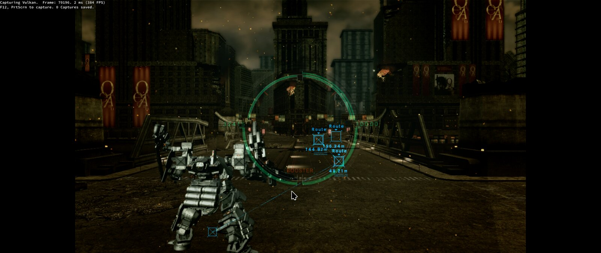

# DEArmoredcoreV

[English](README.md) | [Русский](README.RU.MD)

Research project: reconstruction and a native Linux build of **Armored Core V** (Xbox 360).
PowerPC machine code from `default.xex` is translated into C++ through the ReXGlue SDK and runs on Linux.
In parallel, an independent C/C++ reconstruction of the game's behaviour is being built from retail data.

*Static recompilation of Armored Core V (Xbox 360) into a native Linux port. Research project; no game data included.*



Repository: <https://github.com/GrayRats/DEArmoredcoreV>

> [!IMPORTANT]
> This repository does not include, distribute, or provide access to any game assets.
> It only contains the source code to build the recompilation. You must own a legitimate
> copy of Armored Core V and extract the required assets from it.

> [!CAUTION]
> This project is a work-in-progress. You might experience bugs and crashes;
> full playability has not been verified. See the current status and known blockers below.

> **Not affiliated.** This project is not connected to, and is not endorsed by, the rights holders of Armored Core V.
> Names and trademarks belong to their owners.

## Features

- **Static recompilation.** PowerPC instructions from `default.xex` are translated into C++ and built
  as a native Linux program; no CPU emulation is used at runtime.
- **Vulkan rendering.** The Xenos GPU plugin translates shaders into SPIR-V (glslang); frame debugging
  is done with the RenderDoc replay tools.
- **Resource unpacking.** Scripts for BHD5/BDT, BND3, FLVER, TPF and Xbox 360 textures (BC1) live in `tools/`.
- **Transparent log.** Every analysis and build run is written to the SQLite logger (`tools/decomp-logging`),
  so results are reproducible and verifiable.
- **Independent reconstruction.** A parallel C/C++ reconstruction of behaviour based on retail data;
  the evidence by address and function is listed in [docs/REVERSE_ENGINEERING.md](docs/REVERSE_ENGINEERING.md).

## Current status

Confirmed so far (details and verification steps are in [docs/PROGRESS.md](docs/PROGRESS.md)):

- The native build compiles and runs up to the menu and the intro. In mission 2 the game hangs on a black screen;
  its cause is **not identified**. Evidence: [docs/PROGRESS.md](docs/PROGRESS.md#native-linux),
  [hang analysis](docs/NATIVE_REXGLUE_LINUX.md#error-mission-2-freeze-on-the-accepted-build-the-instrumented-waits-did-not-fire-2026-10-24).
- Resources: all 19,744 BHD5 entries and BND3 entries (including format 0x2c) are unpacked, and 7,111 FLVER headers are parsed;
  the Xbox 360 BC1 layout is confirmed by exact block matches.
- Game logs: `dlc_sound:` is partially mounted from the image data (75 successful opens); the emblems and 7 sounds
  need an image with DLC, which is not in the repository.
- Open: pixel shader emulation, readback verification in the game, and stubs for the kernel functions
  `ObReferenceObject` and `IoDismountVolumeByFileHandle`.

The detailed plan, acceptance criteria and journal are in [docs/PLAN.md](docs/PLAN.md) and [docs/PROGRESS.md](docs/PROGRESS.md).

## Structure

| Path | Contents |
|---|---|
| `tools/native-rexglue/` | kernel host shims (`acv_compat_shims.cpp`), probe and build scripts (`probe_linux.py`, `build_linux.py`), RenderDoc replay tools, tests |
| `tools/decomp-logging/` | SQLite execution logger (`cli.mjs`): all analysis and build runs go through it |
| `tools/native-decomp/`, `tools/native-host-probe/` | limited manual models and checks based on retail evidence |
| `tools/*.py` | resource unpacking and checking: `bhd5_extract_all.py`, `bnd3_extract_dir.py`, `flver_inventory.py`, `x360_bc_decode.py`, `bc_tile_match.py`, `spirv_slice.py`, and others |
| `scripts/` | wrappers: `assets.sh`, `decomp.sh`, `ghidra-rpc.sh`, `unity.sh`, `check_repository_payload.py` |
| `docs/` | state, plan, journal, formats and technical reports |
| `logs/` | not published, except for individual evidence files listed in `.gitignore` |

External components (ReXGlue SDK, XenonRecomp, XenosRecomp, c-xbox_tool_2.0.7 and others) are not part of the repository.
They are installed separately and keep their own licenses in their directories.

## Requirements

- Linux x86_64 (development is done on CachyOS/Arch), Clang or GCC, CMake, Ninja.
- ReXGlue SDK 0.10.0, installed separately; the path is set via `CMAKE_PREFIX_PATH` (see
  [tools/native-rexglue/gpu-plugin/README.md](tools/native-rexglue/gpu-plugin/README.md)).
- Python 3 and Node.js (for the logger in `tools/decomp-logging`).
- RenderDoc for frame captures; Ghidra is optional, via `scripts/ghidra-rpc.sh`.
- Your own image of the game. Unpacking is described in [docs/ASSET_FORMATS.md](docs/ASSET_FORMATS.md).

## Quick start

```bash
# 1. Local profile (not published; contains the player name and settings)
cp tools/native-rexglue/acv.config.example tools/native-rexglue/acv.config

# 2. Build the native probe (incremental)
python3 tools/native-rexglue/build_linux.py --jobs 4 \
  --gpu-plugin-artifact tmp/acv-gpu-plugin-build/librexgpu-xenos.so

# 3. Bounded run (150 s) through the logger
node tools/decomp-logging/cli.mjs run --stage linux_probe --timeout-ms 175000 -- \
  python3 tools/native-rexglue/probe_linux.py --seconds 150 --video-driver x11 \
  --user-root tmp/acv-mnk-profile
```

The run is a diagnostic tool, not a game launcher. A `failed` status for probes caused by `dlc_*` noise in the
classifier means a false classification when the child exits with 0; see [docs/SQLITE_LOGGING.md](docs/SQLITE_LOGGING.md).

All analysis, builds and tests must be run through the logger:

```bash
node tools/decomp-logging/cli.mjs run --stage <stage_name> -- <command> [arguments]
```

## Documentation

| Document | Purpose |
|---|---|
| [docs/README.md](docs/README.md) | Navigation: which document to read for which question |
| [docs/PLAN.md](docs/PLAN.md) | Single plan, working rules and acceptance criteria |
| [docs/PROGRESS.md](docs/PROGRESS.md) | Journal of verified results and operations |
| [docs/X360_PROJECT_STATE.md](docs/X360_PROJECT_STATE.md) | Current state and blockers |
| [docs/NATIVE_REXGLUE_LINUX.md](docs/NATIVE_REXGLUE_LINUX.md) | Native Linux line: build, imports, experiments |
| [docs/ASSET_FORMATS.md](docs/ASSET_FORMATS.md) | ISO, BHD5/BDT, DCX, BND3, TPF, FLVER, textures |
| [docs/ARCHITECTURE.md](docs/ARCHITECTURE.md) | Runtime layers and boundaries |
| [docs/REVERSE_ENGINEERING.md](docs/REVERSE_ENGINEERING.md) | Evidence by address and function |
| [docs/LINUX_INPUT.md](docs/LINUX_INPUT.md) | Keyboard, mouse, configuration |
| [docs/SQLITE_LOGGING.md](docs/SQLITE_LOGGING.md) | Logger: commands, history, retries |
| [docs/ACV_TIMING.md](docs/ACV_TIMING.md), [docs/GHIDRA_CAPTURE.md](docs/GHIDRA_CAPTURE.md) | Timing and Ghidra captures |
| [docs/fine/](docs/fine/) | Condensed reports on postponed branches; archives excluded |
| [ABOUT_DE-AC5.MD](ABOUT_DE-AC5.MD) | Process overview: from ISO to C++ and runtime |
| [TASK-SQL.MD](TASK-SQL.MD) | Policy for the persistent journal and recovery |

## For agents and contributors

- [AGENTS.md](AGENTS.md) — working rules for AI agents and contributors: what to check, what must not be
  changed without permission, and how to record results.
- Before making changes, read [docs/PLAN.md](docs/PLAN.md), then the latest entries in
  [docs/PROGRESS.md](docs/PROGRESS.md).
- The original ISO and the live Ghidra database are read-only.
- Screenshots and PNG previews are not kept for analysis: the evidence is logs, RenderDoc RDC/XML,
  instructions and numeric dumps.

## Acknowledgements

[ReXGlue](https://github.com/rexglue/rexglue-sdk) and [Xenia](https://xenia.jp/) — the runtime this port stands
on; [XenonRecomp](https://github.com/hedge-dev/XenonRecomp) and the recompilation projects that showed the way.

[Armored-core-ReAnswered](https://github.com/rensoftworks/Armored-core-ReAnswered/) is a reference for future
improvements. [TRG Launcher](https://github.com/TekRantGaming/trg-launcher) is the selected GUI for the
[launcher migration plan](PLAN_GUI.MD). [extract-xiso](https://github.com/XboxDev/extract-xiso) provides disc-image
extraction tooling. Local checkout revisions and usage notes: [tool selection guide](TOOLS.MD).

## License

The project's code and documentation are distributed under the **GNU General Public License v3.0 (only)** —
see [LICENSE](LICENSE). Third-party components (ReXGlue SDK, XenonRecomp, XenosRecomp, RenderDoc,
libraries in `thirdparty/`) keep their own licenses; GPL-3.0 does not replace them.
Armored Core V game data is not part of the project's license and is not distributed.
